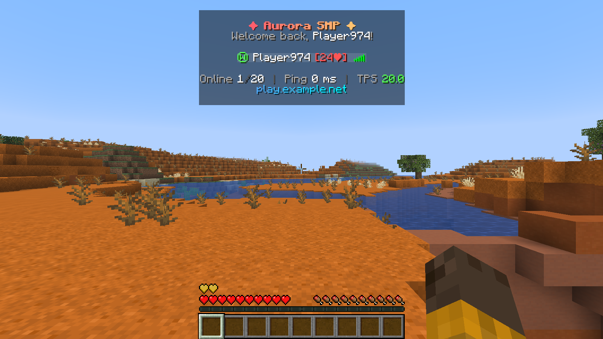
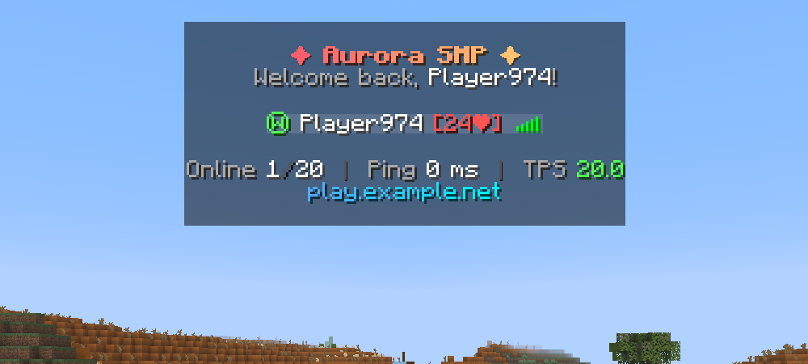
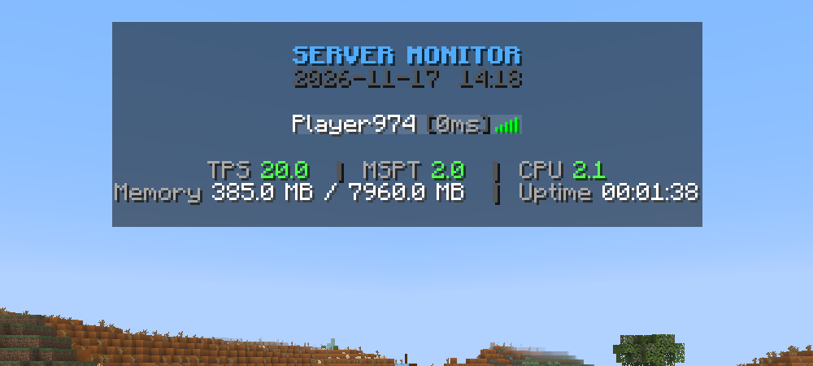
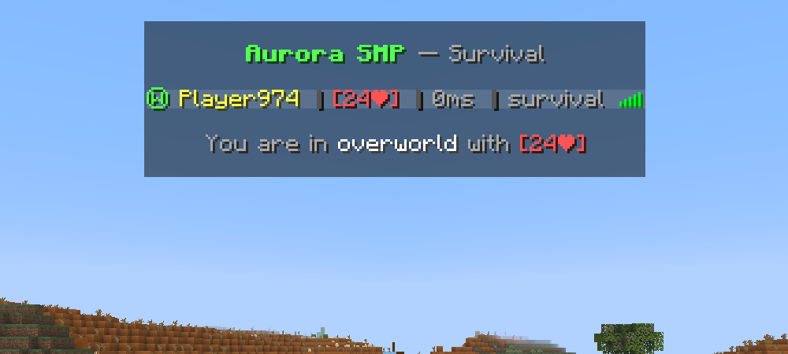
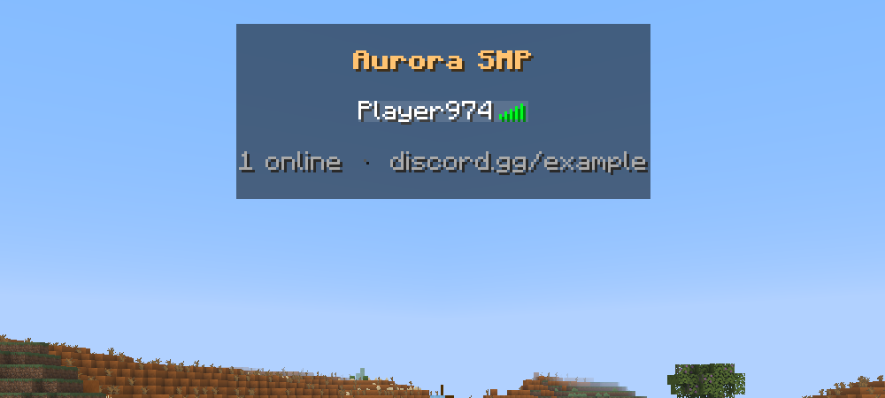

<!-- github-only -->
<div align="center">

# Better TabList

**A fully customizable, server-side tab list for Fabric and NeoForge.**

[](https://modrinth.com/mod/better-tablist)
[](https://modrinth.com/mod/better-tablist/versions)
[](https://modrinth.com/mod/better-tablist/changelog)
[](https://github.com/sennecools/Better-TabList/actions/workflows/build.yml)

[**Download**](https://modrinth.com/mod/better-tablist/versions) · [Examples](#examples) · [Configuration](#configuration) · [Report a bug](https://github.com/sennecools/Better-TabList/issues/new/choose)



</div>
<!-- /github-only -->

A customizable, server-side tab list with animated headers and footers, rank prefixes, player status, and live server statistics.

> **Install it on the server only.** Players join with a normal vanilla client. LuckPerms, FTB Ranks and spark are optional.

## Highlights

| | |
|---|---|
| 🎨 **Colors & gradients** | `&` codes, `&#RRGGBB` hex colors and two gradient syntaxes, with bold, italic and other formatting kept intact. |
| 🎞️ **Animated header & footer** | Any number of frames that cycle automatically, at a speed you choose. |
| 🏷️ **Rich player names** | Dimension symbol, health with absorption, ping, game mode and AFK status next to each name. |
| 👑 **Ranks** | Optional LuckPerms prefixes, suffixes and groups, or FTB Ranks, plus sorting by rank weight. |
| 📈 **Live server stats** | Color-coded TPS, MSPT and CPU, memory and uptime, with spark rolling averages and percentiles when installed. |
| 💤 **AFK detection** | Names turn grey and `#AFK` appears after a configurable idle time. |
| ⚡ **Lightweight** | Packets are only sent when content changes, and metrics are sampled once per update for all players. |
| 🔁 **Hot reload** | Edit `config/tablist.toml` and run `/tablist reload`, no restart needed. |

## Supported versions

| Minecraft | Fabric | NeoForge | Java |
|---|:---:|:---:|:---:|
| **26.1 – 26.3** (26.1, 26.1.1, 26.1.2, 26.2, 26.3) | ✅ | ✅ | 25 |
| **1.21 – 1.21.11** (every release) | ✅ | ✅ | 21 |

Every Minecraft release has its own JAR per loader. Pick the file that matches your server's exact Minecraft version.

## Installation

1. [Download](https://modrinth.com/mod/better-tablist/versions) the JAR for your server's **Minecraft version and loader**.
2. Put it in the server's `mods/` folder. **Fabric servers also need [Fabric API](https://modrinth.com/mod/fabric-api).**
3. Start the server once to generate `config/tablist.toml`.
4. Set `server_name`, then customize the header, footer and player names, or start from one of the [examples](#examples).
5. Run `/tablist reload` as an operator (permission level 2), or restart the server.

## Examples

Each example is a complete, ready-to-use config. Copy it into `config/tablist.toml` and run `/tablist reload`. All screenshots are from a real Minecraft 26.3 server.

### Gradient showcase

A bold gradient title, a personal welcome line and a compact status footer.



<details>
<summary><b>Show config</b> · <a href="docs/examples/gradient-showcase.toml">gradient-showcase.toml</a></summary>

```toml
[appearance]
server_name = "Aurora SMP"
header = [
    "#N<gradient:#FF5F6D:#FFC371>&l✦ #SERVERNAME ✦</gradient>&r#N&7Welcome back, &f#PLAYERNAME&7!#N"
]
footer = [
    "#N&7Online &f#PLAYERCOUNT&8/&f#MAXPLAYERS  &8┃  &7Ping &f#PING ms  &8┃  &7TPS #CTPS#N<gradient:#4FACFE:#00F2FE>play.example.net</gradient>#N"
]
name_formatting_provider = "NONE"
display_name_format = "{dimension} &f{name} {health} &7#AFK"

[sorting]
sort_mode = "ALPHABETICAL"
```

</details>

### Performance dashboard

Live, color-coded server health for admins and modpack servers. Install [spark](https://modrinth.com/mod/spark) and set `metrics_provider = "SPARK"` for rolling TPS and MSPT percentiles.



<details>
<summary><b>Show config</b> · <a href="docs/examples/performance-dashboard.toml">performance-dashboard.toml</a></summary>

```toml
[appearance]
server_name = "Aurora SMP"
header = [
    "#N&#4FACFE&lSERVER MONITOR#N&8#DATE  #TIME#N"
]
footer = [
    "#N&7TPS #CTPS  &8│  &7MSPT #CMSPT  &8│  &7CPU #CCPU#N&7Memory &f#MEMORY  &8│  &7Uptime &f#UPTIME#N"
]
name_formatting_provider = "NONE"
display_name_format = "&f{name} &8[&7{ping}ms&8]"
update_interval = 1000

[performance]
metrics_provider = "VANILLA"
```

</details>

### Survival status

Every name shows the player's dimension, health, ping and game mode at a glance.



<details>
<summary><b>Show config</b> · <a href="docs/examples/survival-status.toml">survival-status.toml</a></summary>

```toml
[appearance]
server_name = "Aurora SMP"
header = [
    "#N&a&l#SERVERNAME &r&7— Survival#N"
]
footer = [
    "#N&7You are in &f#WORLD &7with #HEALTH#N"
]
name_formatting_provider = "NONE"
display_name_format = "{dimension} &e{name} &8│ {health} &8│ &7{ping}ms &8│ &7{gamemode} &7#AFK"

[afk]
afk_enabled = true
afk_timeout = 300
```

</details>

### Animated & minimal

Three header frames that cycle every ~2 seconds, and nothing more.



<details>
<summary><b>Show config</b> · <a href="docs/examples/animated-minimal.toml">animated-minimal.toml</a></summary>

```toml
[appearance]
server_name = "Aurora SMP"
header = [
    "#N&f&l#SERVERNAME#N",
    "#N&#FFC371&l#SERVERNAME#N",
    "#N&#FF5F6D&l#SERVERNAME#N"
]
footer = [
    "#N&7#PLAYERCOUNT online  &8·  &7discord.gg/example#N"
]
name_formatting_provider = "NONE"
display_name_format = "&f{name}"
update_interval = 500
animation_interval = 4
```

</details>

## Configuration

All settings live in `config/tablist.toml`. Keep text values in quotes, use unquoted `true` / `false` for switches, and edit the existing sections rather than adding a second `[appearance]`.

| Section | What it controls |
|---|---|
| `[appearance]` | Server name, header/footer frames, player-name format, rank provider, refresh timing |
| `[sorting]` | Player order: `NONE`, `ALPHABETICAL` or `RANK` |
| `[afk]` | AFK detection and its timeout **in seconds** (`300` = 5 minutes) |
| `[performance]` | Metrics source: `VANILLA` or `SPARK` |

Existing configs remain compatible. Your names and formats are kept, and the old `ftbranks.enable_ftbranks_formatting` setting chooses a provider when `name_formatting_provider` is missing.

### Header & footer

Each quoted item is **one animation frame**. Use `#N` for a new line inside a frame.

- **One item:** static text. **Two or more:** animated. **`[]`:** hide the header or footer.
- `update_interval = 500` refreshes every **500 milliseconds**.
- `animation_interval = 4` switches frames every **4 refreshes**, about **2 seconds** at the default refresh rate.

### Player names

Set `name_formatting_provider` and `display_name_format` in `[appearance]`:

| Setup | `name_formatting_provider` | `display_name_format` |
|---|---|---|
| Plain names | `"NONE"` | `"{name} &7#AFK"` |
| Dimension and health | `"NONE"` | `"{dimension} {name} {health} &7#AFK"` |
| [LuckPerms](https://luckperms.net/download) | `"LP"` | `"{prefix}{name}{suffix}&r &7#AFK"` |
| FTB Ranks | `"FTB"` | `"[{rank}] {name} &7#AFK"` |

With FTB Ranks, a player's `ftbranks.name_format` permission **takes precedence** over your format. Choose `NONE` to always use the config format. The default provider is `FTB` for compatibility, and the mod works fine without any rank mod installed.

### Sorting and spark

```toml
[sorting]
sort_mode = "RANK" # NONE, ALPHABETICAL or RANK

[performance]
metrics_provider = "SPARK" # VANILLA or SPARK
```

`RANK` sorts by the highest inherited LuckPerms group weight or FTB rank power, then alphabetically. Players already on another scoreboard team stay on that team. Rolling TPS and MSPT percentiles require [spark](https://modrinth.com/mod/spark). Without it, TPS/MSPT/CPU use built-in measurements and rolling statistics show `N/A`.

### Placeholders

Player-specific values refer to the player viewing the tab list. These placeholders work in headers, footers and `display_name_format`.

<details>
<summary><b>Server & player placeholders</b></summary>

| Placeholder | Description |
|---|---|
| `#N` | New line |
| `#SERVERNAME` | Server name from the config |
| `#PLAYERCOUNT` / `#MAXPLAYERS` | Online players / maximum player slots |
| `#PLAYERNAME` | Viewing player's name |
| `#PING` | Player ping in ms |
| `#RANK` | FTB rank or LuckPerms primary group, from the selected provider |
| `#AFK` | `AFK` while the player is AFK, empty otherwise |
| `#WORLD` | Player's current dimension |
| `#DIMENSION` | Colored dimension symbol (Ⓦ / Ⓝ / Ⓔ), or a custom dimension name |
| `#HEALTH` | Health + absorption, e.g. `[20❤]` (20 health points = 10 hearts) |
| `#DATE` / `#TIME` | Real date (`yyyy-MM-dd`) / time (`HH:mm`) |

</details>

<details>
<summary><b>Performance placeholders</b></summary>

| Placeholder | Description |
|---|---|
| `#TPS` / `#CTPS` | Estimated TPS (vanilla) or 1-minute TPS (spark), plain / colored |
| `#MSPT` / `#CMSPT` | Milliseconds per tick, plain / colored |
| `#CPU` / `#CCPU` | Server process CPU usage, plain / colored |
| `#TPS_1M` / `#CTPS_1M` | 1-minute TPS, plain / colored (spark) |
| `#TPS_5M` / `#CTPS_5M` | 5-minute TPS, plain / colored (spark) |
| `#MSPT_P95` / `#CMSPT_P95` | 1-minute MSPT 95th percentile, plain / colored (spark) |
| `#MEMORY` | Memory usage (used / max) |
| `#UPTIME` | Server uptime |

Colors use green / yellow / red thresholds: TPS ≥18 / ≥15 / <15, MSPT ≤40 / ≤50 / >50, CPU ≤60% / ≤85% / >85%. Vanilla TPS is estimated from the average tick time. Unsupported measurements show `N/A`.

</details>

<details>
<summary><b>Player-name placeholders</b></summary>

| Placeholder | Description |
|---|---|
| `{name}` | Player name |
| `{rank}` | FTB rank or LuckPerms primary group |
| `{prefix}`, `{suffix}` | LuckPerms prefix / suffix in the player's current context |
| `{primary_group}` | LuckPerms primary group |
| `{dimension}` | Colored dimension symbol, or custom dimension name |
| `{health}` | Colored health + absorption indicator |
| `{world}`, `{ping}`, `{gamemode}` | Dimension name, ping in ms and game mode |

`{prefix}`, `{suffix}` and `{primary_group}` require the `LP` provider. Unavailable integration values are empty. AFK detection watches movement, turning and chat.

</details>

### Colors

| Syntax | Example |
|---|---|
| Standard codes | `&a` green, `&c` red, `&l` bold, `&o` italic, `&r` reset |
| Hex colors | `&#FF5555` |
| Gradient (MiniMessage style, 2+ colors) | `<gradient:#FF0000:#FFAA00:#0000FF>text</gradient>` |
| Gradient (TAB style) | `<#FF0000>text</#0000FF>` |

### Starter config

<details>
<summary><b>Complete starter config</b></summary>

For a new setup only. For an existing setup, edit the matching settings instead of replacing your config.

```toml
[appearance]
server_name = "My Server"
header = [
    "#N&a&l#SERVERNAME&r#N&7Welcome, #PLAYERNAME!#N"
]
footer = [
    "#N&fOnline: &e#PLAYERCOUNT&7/&e#MAXPLAYERS#N&7TPS: #CTPS &7| MSPT: #CMSPT#N"
]
name_formatting_provider = "NONE"
display_name_format = "{name} &7#AFK"
update_interval = 500
animation_interval = 4

[sorting]
sort_mode = "NONE"

[afk]
afk_enabled = true
afk_timeout = 300

[performance]
metrics_provider = "VANILLA"
```

</details>

## FAQ

<details>
<summary><b>My LuckPerms prefix is missing.</b></summary>

Select `LP`, include `{prefix}` in your format, and check that the player has a prefix in their current LuckPerms context.
</details>

<details>
<summary><b>My config name format does not apply with FTB Ranks.</b></summary>

Check the `ftbranks.name_format` permission. When it is present, it takes precedence. Select `NONE` to always use your config format.
</details>

<details>
<summary><b>Extra header items do not show up as extra lines.</b></summary>

Each item is an animation frame. Use `#N` to add lines inside one frame.
</details>

<details>
<summary><b>I see <code>N/A</code> in spark statistics.</b></summary>

Select `SPARK` and check that spark is installed and ready. Statistics that are not supported show `N/A`.
</details>

<details>
<summary><b>How do I apply changes?</b></summary>

Run `/tablist reload` as an operator, or restart. Invalid TOML, such as a missing quote or a duplicate section, must be fixed before reloading.
</details>

<details>
<summary><b>Do players need to install anything?</b></summary>

No. Better TabList only runs on the server and works with vanilla clients.
</details>

Need help? [Open an issue](https://github.com/sennecools/Better-TabList/issues/new/choose) with your Minecraft version, loader and the relevant config settings.

## Contributors

- **sennecools** and **NeofastFTL** — Better TabList
- **[MihailDenisov](https://github.com/MihailDenisov)** — original LuckPerms integration, dimension/health display, rank-weight caching and performance-metric ideas/code from the [LPintegration branch](https://github.com/MihailDenisov/Better-TabList/tree/LPintegration), adapted for all supported targets ([issue #13](https://github.com/sennecools/Better-TabList/issues/13)).

Inspired by [Tab List](https://modrinth.com/mod/tab-list).

<!-- modrinth-end -->

## Development

### Building from source

Gradle runs on **Java 25** and downloads it automatically if it is missing (`gradle/gradle-daemon-jvm.properties`). The 1.21.x targets still compile for Java 21.

```sh
./gradlew build                                          # all 34 targets, with tests
./gradlew :26.3-fabric:build --configure-on-demand       # a single target
```

JARs are written to `versions/<minecraft>-<loader>/build/libs/`.

### Project layout

```text
src/main/java/com/sennecools/tablist/
├── TabListUpdater.java        # tick loop, header/footer packets, AFK tracking, sorting teams
├── TabListVariables.java      # placeholders, color codes, gradients → Component
├── config/                    # tablist.toml loading, defaults and migration
├── metrics/                   # TPS / MSPT / CPU, vanilla and spark providers
├── platform/                  # PlatformHelper interface (ServiceLoader)
├── fabric/                    # Fabric entrypoint, ServerPlayer mixin
└── neoforge/                  # NeoForge entrypoint and events
versions/<minecraft>-<loader>/gradle.properties   # per-target dependency versions
docs/examples/                 # the example configs shown above
```

### How it works

- **One source tree, 34 JARs.** `settings.gradle` registers 17 Minecraft versions × 2 loaders as [Stonecutter](https://stonecutter.kikugie.dev/) targets. Each is built with `fabric.gradle` (Fabric Loom), `fabric-unobfuscated.gradle` (Fabric Loom without remapping, for the unobfuscated 26.1+ releases) or `neoforge.gradle` (ModDevGradle). API differences between versions are handled with Stonecutter comment predicates such as `//? if >=1.21.9` in the shared code.
- **Loader differences sit behind one interface.** `platform/PlatformHelper` is loaded through `ServiceLoader`, with one implementation per loader. Tab list names come from a mixin on `ServerPlayer.getTabListDisplayName` on Fabric and from the `PlayerEvent.TabListNameFormat` event on NeoForge.
- **Optional mods stay optional.** LuckPerms, FTB Ranks and spark are `compileOnly` dependencies. Their classes are only touched after an `isModLoaded` check, and the spark lookup also catches `LinkageError` and falls back to built-in measurements.
- **Text formatting** happens in `TabListVariables`: `convertColorCodes` expands `&` codes, `&#RRGGBB` and both gradient syntaxes into legacy `§` codes (one interpolated hex color per character for gradients), and `parseColoredText` turns that into a styled `Component`.
- **Sorting** assigns players to numbered scoreboard teams (`tl_…`). Players already on another team are left alone.

### Tests and CI

JUnit 5 tests cover the color/gradient parser, config defaults, migration and reload, the metrics placeholders and spark fallback, and the LuckPerms lookup.

Every push and pull request runs one GitHub Actions check **per Minecraft version and loader**. Each check builds the target, runs the tests, then boots a real dedicated server with the mod and verifies over RCON that it loads, writes its config and handles `/tablist reload`. A weekly workflow opens an issue when a new Minecraft release comes out.

```sh
./gradlew :26.3-fabric:test --configure-on-demand              # unit tests for one target
scripts/ci/server-smoke-test.sh 26.3-fabric                   # the same server check CI runs
```

### Releasing

1. Bump `mod_version` in `gradle.properties` and add a `## What's New in <version>` section to the top of `CHANGELOG.md`.
2. Push a tag `v<version>`. The **Release** workflow builds every target, publishes them to Modrinth (needs the `MODRINTH_TOKEN` repository secret) and creates a GitHub release with all JARs.

To sync this README to the Modrinth project page, set `MODRINTH_TOKEN` with the `PROJECT_WRITE` scope and run `./gradlew updateModrinthDescription --configure-on-demand`. Everything above the `modrinth-end` marker is published, without the GitHub-only header.

## License

All Rights Reserved.
